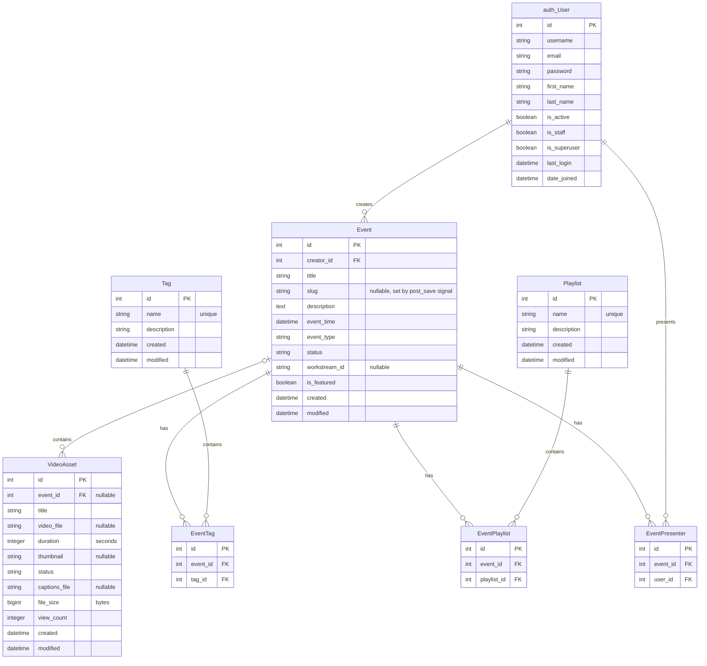

## Notes

- The source of truth is `events/models.py`. Update this diagram in the same change as a model or migration.
- `EventTag` and `EventPlaylist` are the join tables Django generates for `Event.tags` and `Event.playlists` (`events_event_tags`, `events_event_playlists`); they are not separate models and have no timestamps.
- `EventPresenter` is an explicit model with `unique_together = (event, user)`.
- `event_type` is `SESSION`. `Event.status` is `DRAFT`, `PUBLISHED` or `ARCHIVED`, defaulting to `DRAFT`. `VideoAsset.status` is `PROCESSING`, `READY` or `FAILED`.
- A `VideoAsset` can exist without an event: the upload endpoint creates the asset first, and the event-creation endpoint attaches it.
- The explicit foreign keys (`Event.creator`, `VideoAsset.event`, `EventPresenter.event`, `EventPresenter.user`) use `on_delete=DO_NOTHING`.
- `VideoAsset.video_file` only accepts the `mp4`, `mov`, `avi` and `webm` extensions.
- `auth_User` is Django's built-in user model; the `users` app defines no models.
